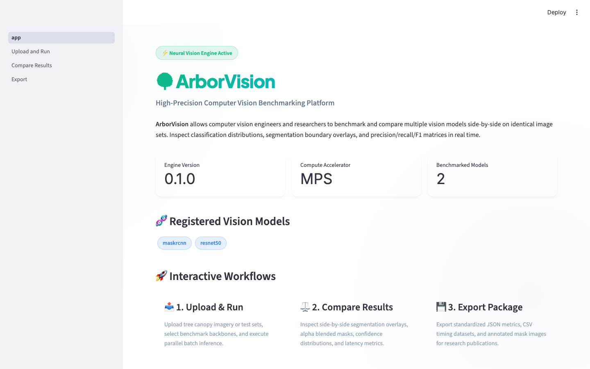
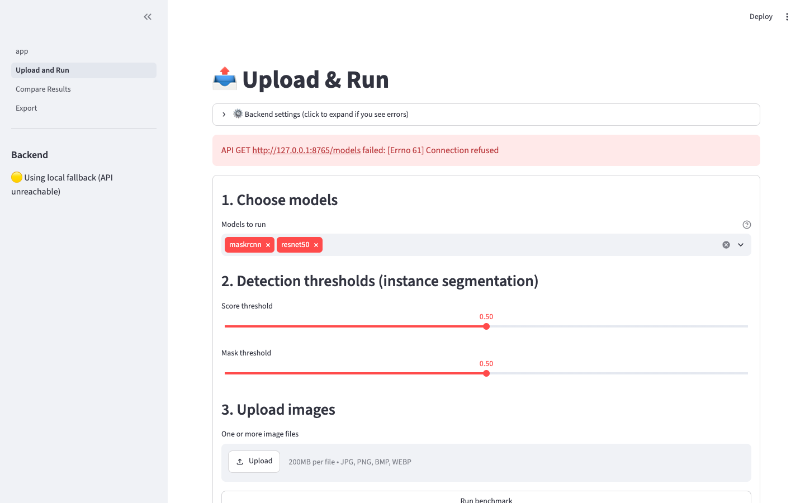
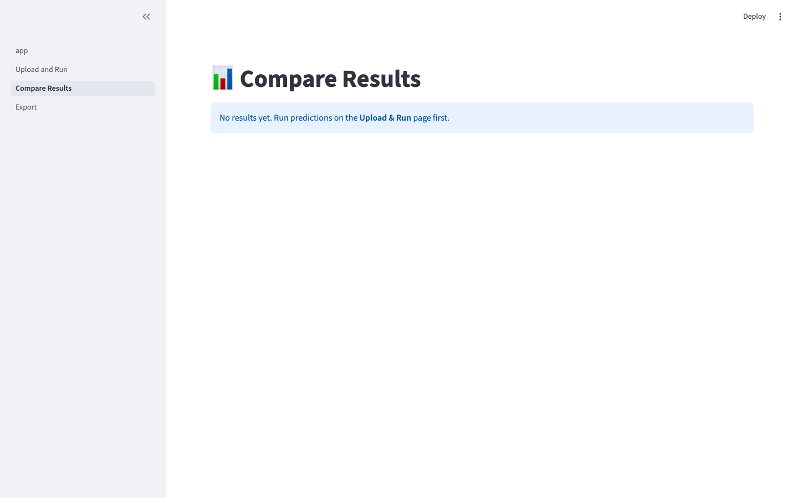
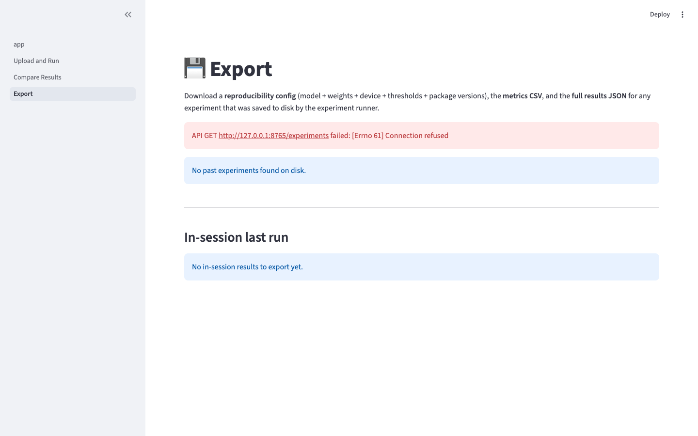

# ArborVision

**Computer Vision Benchmarking Platform** — upload images, run multiple vision
models side-by-side, and compare their predictions and metrics
(classification, instance segmentation, precision/recall/F1, inference time).

> *Arbor* (Latin: tree) + *Vision* — the first benchmark dataset is tree imagery,
> tying into tree-species classification and UAV research.


---

## Table of contents

1. [What is ArborVision?](#what-is-arborvision)
2. [Features](#features)
3. [Prerequisites](#prerequisites)
4. [Installation](#installation)
5. [Verify the install](#verify-the-install)
6. [Add a tree dataset](#add-a-tree-dataset)
7. [Running the platform](#running-the-platform)
   - [A. Web UI (recommended for first-time users)](#a-web-ui-recommended-for-first-time-users)
   - [B. Command-line (no UI)](#b-command-line-no-ui)
   - [C. REST API (for code/scripts)](#c-rest-api-for-codescripts)
8. [Output artifacts](#output-artifacts)
9. [Adding your own model](#adding-your-own-model)
10. [Project layout](#project-layout)
11. [Running the tests](#running-the-tests)
12. [Troubleshooting](#troubleshooting)
13. [Known limitations](#known-limitations)
14. [Contributing](#contributing)
15. [License](#license)

---

## What is ArborVision?

ArborVision is a single-user research tool for **comparing computer vision
models** on the same images. It is built around three ideas:

1. **A common adapter interface** so any model (classification, instance
   segmentation, object detection) can be plugged in without changing the
   rest of the code.
2. **Reproducible experiments** — every run captures the model name, weights,
   device, thresholds, package versions, and git SHA so a re-run produces
   the same numbers.
3. **Side-by-side comparison** — confusion matrix, precision / recall / F1,
   mIoU, mAP@0.5, and inference time, plus visual overlays of every
   prediction.

The first benchmark dataset is **tree imagery** (oak, maple, pine, …) but
the platform is task-agnostic — point it at any image folder and any
registered model.

---

## Features

- **Multi-model comparison** — plug in new models via a common adapter interface
- **Classification & instance segmentation** in one platform
- **Metrics**: confusion matrix, precision, recall, F1, mIoU, mAP@0.5, latency (mean / p50 / p95)
- **Visual overlays** for predicted masks and bounding boxes
- **Reproducible experiments** with serialized checkpoints (model + weights + config)
- **Result exports** to JSON, CSV, and a ZIP of annotated images
- **Local-first** — runs entirely on your machine, no cloud dependency

---

## Screenshots & Visual Walkthrough

| Benchmarking Platform Overview | Upload Images & Run Models |
| :---: | :---: |
|  |  |

| Side-by-Side Model Comparison | Benchmark Export (CSV/JSON/ZIP) |
| :---: | :---: |
|  |  |

---

## Prerequisites

| Requirement | Minimum | Notes |
|---|---|---|
| **OS** | macOS, Linux, Windows (WSL2 recommended) | Tested on macOS 14+ |
| **Python** | 3.10 or newer | 3.12 recommended |
| **RAM** | 8 GB | 16 GB+ recommended for Mask R-CNN |
| **Disk** | ~5 GB free | For PyTorch + torchvision model weights (downloaded on first use) |
| **GPU** | Optional | CUDA (NVIDIA), MPS (Apple Silicon), or CPU-only. Auto-detected. |

### System libraries (Linux only)

If you're on Linux you'll need a few system packages for OpenCV and Pillow:

```bash
# Debian / Ubuntu
sudo apt-get install -y libgl1 libglib2.0-0 libsm6 libxext6 libxrender1

# Fedora / RHEL
sudo dnf install -y glib2 libGL libSM libXext libXrender
```

macOS and Windows users do **not** need to install anything else.

### Hardware acceleration

ArborVision auto-selects the best device in this order:

1. **CUDA** (NVIDIA GPU) — fastest
2. **MPS** (Apple Silicon M1/M2/M3/M4) — fast, no extra setup
3. **CPU** — always works, ~10× slower for Mask R-CNN

The selected device is shown on the home page of the Streamlit UI and at
`GET /health` in the API.

---

## Installation

### 1. Clone the repository

```bash
git clone https://github.com/arafatsheikh/arborvision.git
cd arborvision
```

### 2. Create a virtual environment

A virtual environment keeps ArborVision's dependencies isolated from your
system Python.

```bash
# macOS / Linux
python3 -m venv .venv
source .venv/bin/activate

# Windows (PowerShell)
python -m venv .venv
.\.venv\Scripts\Activate.ps1
```

> **Tip:** you'll need to re-run the `source` line every time you open a
> new terminal.

### 3. Install the package in editable mode

```bash
pip install --upgrade pip
pip install -e .
```

The first install will take a few minutes because PyTorch wheels are large
(~750 MB for the CUDA build, smaller for CPU/MPS).

### 4. (Optional) Install dev tools for running tests

```bash
pip install -e ".[dev]"
```

---

## Verify the install

Quick smoke test — this should print the model names without erroring:

```bash
python -c "from arborvision.models import list_models; print(list_models())"
```

Expected output:

```
['maskrcnn', 'resnet50']
```

If you see that, your environment is ready.

> **Note:** The first time you actually *use* a model (e.g. via the API or
> the CLI), torchvision will download the pretrained weights to
> `~/.cache/torch/hub/checkpoints/`. This is a one-time ~170 MB download.

---

## Add a tree dataset

The benchmark expects an **ImageFolder** layout: one subdirectory per
class, with image files inside.

```
data/tree_species/
├── oak/
│   ├── oak_001.jpg
│   ├── oak_002.jpg
├── maple/
│   ├── maple_001.jpg
├── pine/
│   ├── pine_001.jpg
```

You can use any folder layout you like — the only requirement is that
each image lives under a subdirectory whose name becomes the class label
when you pass `--labeled` to the CLI.

**Where do I get tree images?**

- Your own UAV / field photos
- Public datasets: [TreeSpecies](https://www.kaggle.com/datasets),
  [iNaturalist](https://www.inaturalist.org/), or
  [PlantVillage](https://plantvillage.psu.edu/)
- Synthetic: any folder of JPEG/PNG files works

> The `data/tree_species/` folder ships empty (it's gitignored) so the
> benchmark gracefully runs against zero images — you'll just get an
> empty experiment.

---

## Running the platform

ArborVision has three ways to interact with it. Pick whichever fits.

### A. Web UI (recommended for first-time users)

The Streamlit UI is the most visual way to explore. It needs the FastAPI
backend running.

**Terminal 1 — start the API:**

```bash
uvicorn arborvision.api.server:app --reload --port 8000
```

You should see:

```
INFO:     Uvicorn running on http://127.0.0.1:8000 (Press CTRL+C to quit)
```

**Terminal 2 — start the UI:**

```bash
streamlit run app.py
```

Your browser should open to `http://localhost:8501` automatically. The
landing page will tell you the API is connected (green dot) or that the
UI is in local-fallback mode (yellow dot — predictions still work, but
in-process instead of over HTTP).

**UI walkthrough:**

1. **Upload & Run** (sidebar) — drag in one or more images, pick models,
   click "Run benchmark".
2. **Compare Results** — see original + overlay side by side per model,
   plus a confusion matrix and a latency bar chart.
3. **Export** — download a JSON / CSV / annotated-images ZIP of your run.

If you need to point the UI at a different API host (e.g. a remote
machine), expand **Backend connection** on the home page and set the
URL.

### B. Command-line (no UI)

If you just want to benchmark a folder of images and write results to
disk:

```bash
python -m arborvision.experiments.runner \
    --images data/tree_species \
    --models maskrcnn resnet50 \
    --labeled \
    --output data/results/run_001
```

Useful flags:

| Flag | What it does |
|---|---|
| `--images PATH` | Folder of images (recursive). |
| `--models A B C` | One or more registered model names. |
| `--labeled` | Treat subdirs as class labels. Without this, no classification metrics are computed. |
| `--output PATH` | Where to write results. Default: `data/results/<UTC timestamp>`. |
| `--score-threshold 0.5` | Minimum detection confidence. |
| `--n-warmup 2` | Untimed warmup calls per image. |
| `--n-runs 10` | Timed runs per image for latency stats. |
| `--no-overlays` | Skip writing annotated PNGs. |

Run `python -m arborvision.experiments.runner --help` for the full list.

### C. REST API (for code/scripts)

Start the server (same as in option A) and call it from any HTTP client.

```bash
# Health
curl http://127.0.0.1:8000/health

# List registered models
curl http://127.0.0.1:8000/models

# Run a prediction on a local image
curl -X POST http://127.0.0.1:8000/predict \
    -F "model_names=resnet50,maskrcnn" \
    -F "files=@path/to/your_image.jpg"
```

Interactive API docs are auto-generated at
**`http://127.0.0.1:8000/docs`** (Swagger UI) and
**`http://127.0.0.1:8000/redoc`**.

---

## Output artifacts

Every experiment produces this directory tree:

```
data/results/<experiment_id>/
├── config.json         # Reproducibility: model, device, versions, git SHA
├── results.json        # Full structured result (predictions + metrics)
├── metrics.csv         # One row per (model, image): top-1 label, score, latency
├── experiment.zip      # Everything above + overlays, ready to share
└── overlays/
    ├── maskrcnn/
    │   ├── oak__oak_001.png
    │   └── maple__maple_001.png
    └── resnet50/
        ├── oak__oak_001.png
        └── maple__maple_001.png
```

The `__` in overlay filenames joins the parent class directory with the
image stem, so two images named `img_1.jpg` in different classes don't
overwrite each other.

**`config.json` example:**

```json
{
  "experiment_id": "20260101T120000Z",
  "model_names": ["maskrcnn", "resnet50"],
  "device": "mps",
  "score_threshold": 0.5,
  "image_paths": ["data/tree_species/oak/oak_001.jpg"],
  "ground_truth_labels": ["oak"],
  "package_versions": {
    "torch": "2.1.0",
    "torchvision": "0.16.0",
    "arborvision": "0.1.0",
    "python": "3.12.1"
  },
  "git_sha": "a1b2c3d4..."
}
```

---

## Adding your own model

ArborVision's strength is that any new model only needs to implement one
interface. Here's a minimal example — drop this into
`arborvision/models/my_model.py`:

```python
import numpy as np
from arborvision.models.base import ModelAdapter, ModelMetadata, Prediction


class MyYoloAdapter(ModelAdapter):
    name = "yolov8"
    task = "object_detection"  # or "classification" / "instance_segmentation"

    def __init__(self):
        # Load your model here, e.g.:
        # from ultralytics import YOLO
        # self.model = YOLO("yolov8n.pt")
        self.model = None  # placeholder

    def predict(self, image: np.ndarray) -> Prediction:
        # image is RGB uint8, shape (H, W, 3)
        # Return a Prediction with whatever you can detect
        return Prediction(
            labels=["my_class"],
            scores=[0.9],
            boxes=[(10, 10, 100, 100)],
            masks=[],
        )

    def warmup(self) -> None:
        # Run a dummy forward pass
        pass

    def metadata(self) -> ModelMetadata:
        return ModelMetadata(
            name=self.name,
            task=self.task,
            description="My custom YOLO model",
            device="cpu",
            weights="yolov8n.pt",
        )
```

Then register it in `arborvision/models/registry.py`:

```python
def _register_builtins() -> None:
    if "maskrcnn" in _FACTORIES:
        return
    from .maskrcnn import MaskRCNNAdapter
    from .classifier import ResNet50Adapter
    from .my_model import MyYoloAdapter          # <-- add this

    register("maskrcnn", MaskRCNNAdapter)
    register("resnet50", ResNet50Adapter)
    register("yolov8", MyYoloAdapter)            # <-- and this
```

Restart the API (`uvicorn` with `--reload` will do this automatically) and
your model will appear in `/models`, in the CLI's `--models` list, and in
the Streamlit dropdown.

---

## Project layout

```
arborvision/
├── models/        # ModelAdapter ABC + concrete adapters (Mask R-CNN, ResNet-50, ...)
├── data/          # image loading + overlay drawing + tree-species dataset
├── experiments/    # runner, checkpoint (reproducibility), export
├── metrics/       # classification, segmentation, timing
├── api/           # FastAPI server + pydantic schemas
├── ui/            # Streamlit-side helpers (HTTP client, local fallback)
└── config.py      # paths, device selection, defaults
app.py             # Streamlit entrypoint (landing page)
pages/             # Streamlit multi-page UI (auto-discovered)
data/              # uploads, tree_species benchmark, results (gitignored)
tests/             # pytest suite
```

---

## Running the tests

```bash
pip install -e ".[dev]"
pytest -q
```

You should see:

```
32 passed in ~5s
```

The tests cover metrics math, registry/serialization, the experiment
runner (with a fake model so they run without GPU), and API contract
tests via FastAPI's `TestClient`.

---

## Troubleshooting

### "No module named arborvision"

You forgot to activate the virtual environment, or didn't `pip install -e .`.

```bash
source .venv/bin/activate   # macOS/Linux
pip install -e .
```

### "Address already in use" when starting uvicorn

Port 8000 is taken. Either stop the other process, or pick a different port:

```bash
uvicorn arborvision.api.server:app --port 8001
```

…and update the **Backend connection** URL in the Streamlit UI.

### "Could not decode uploaded bytes as an image"

The file isn't a supported format. ArborVision accepts: `.jpg`, `.jpeg`,
`.png`, `.bmp`, `.webp`, `.tif`, `.tiff`.

### Mask R-CNN is very slow on CPU

That's expected — Mask R-CNN on a 1024×1024 image takes ~5–15 s on CPU.
Use a machine with CUDA, MPS, or pick a smaller image. The `--no-overlays`
flag also speeds things up by skipping the overlay PNG write.

### Streamlit shows a yellow dot (API unreachable)

The UI has a **local fallback mode** that runs models in-process. You can
keep using it, but for full features (per-experiment history, ZIP export
of past runs) start the API too.

### First model run downloads ~170 MB of weights

torchvision downloads pretrained weights on first use. They're cached in
`~/.cache/torch/hub/checkpoints/` and reused forever after. If you're
offline, pre-download with:

```bash
python -c "from torchvision.models.detection import maskrcnn_resnet50_fpn, MaskRCNN_ResNet50_FPN_Weights; maskrcnn_resnet50_fpn(weights=MaskRCNN_ResNet50_FPN_Weights.DEFAULT)"
```

### Tests fail with "torch not installed"

The test suite is designed to run *without* torch. If you see torch
import errors, you're probably running an older version of pytest that
imports everything at collection time. Upgrade:

```bash
pip install -U pytest
```

### Git SHA is `None` in `config.json`

You're not running ArborVision inside a git repository, or `git` isn't on
your `$PATH`. Initialize a repo (`git init && git add -A && git commit -m
"init"`) and re-run.

---

## Known limitations (v1)

- **No multi-user / auth** — single-user, single-machine
- **No cloud storage** — local filesystem only (S3-pluggable interface TBD)
- **No training** — inference + benchmarking only. Bring your own
  fine-tuned checkpoints and plug them in via the adapter pattern.
- **No automatic dataset downloaders** — point at a folder you populate
- **Mask R-CNN only** for instance segmentation in v1 (the adapter pattern
  makes adding SAM / YOLOv8 / etc. a ~50-line change)

---

## Contributing

Pull requests welcome. A few conventions:

- **Lint:** `ruff check arborvision/ tests/`
- **Tests:** `pytest -q` must pass; add a test for new behavior
- **Type hints:** everything in `arborvision/` is type-annotated
- **New models:** add a file under `arborvision/models/`, register in
  `registry.py`, and add a smoke test under `tests/test_models.py`

```bash
pip install -e ".[dev]"
ruff check arborvision/ tests/
pytest -q
```

---

## License

MIT — see `LICENSE` (add one before publishing) or treat as MIT-licensed
until stated otherwise.